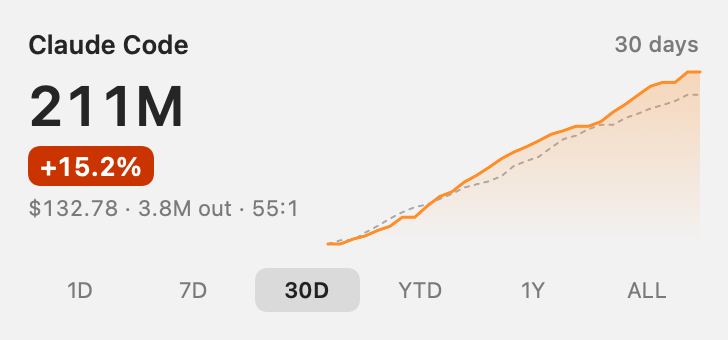
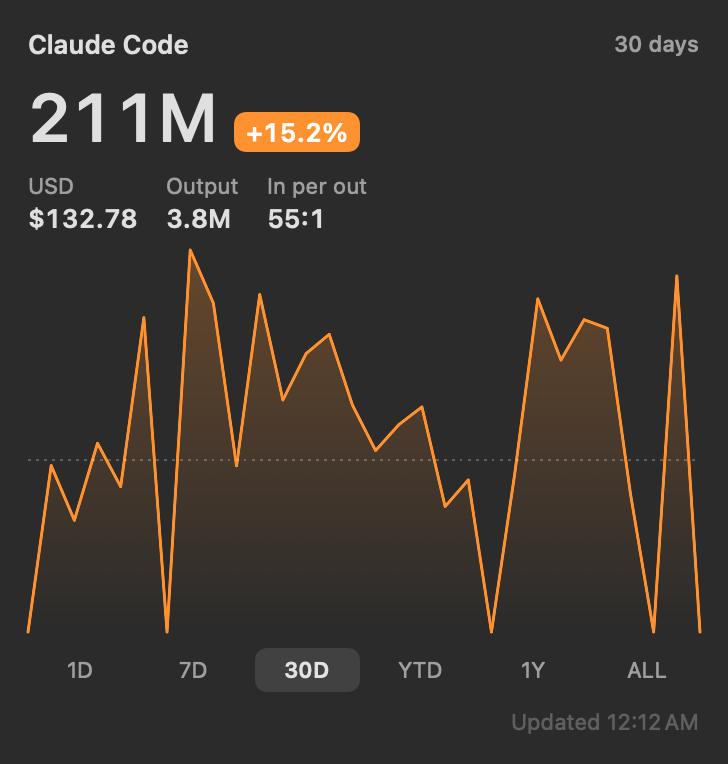

# TokenMaccer

A macOS desktop widget that shows your **Claude Code** token usage like a stock ticker: today, 7 days, 30 days, year to date, 1 year and all time, with the change against the previous period.

> TokenMaccer is an independent project. It is not affiliated with, endorsed by or sponsored by Anthropic. "Claude" and "Claude Code" are trademarks of Anthropic.

<p>
  
  
</p>

*Screenshots use made-up demo data.*

**Download:** [TokenMaccer.dmg](https://github.com/valentinherrera/tokenmaccer/releases/latest/download/TokenMaccer.dmg), notarized, macOS 15 or newer ([details](#download-app), [tokenmaccer.app](https://tokenmaccer.app)). Or build it from source with the steps below.

## What it shows

- **Input tokens** as the headline (uncached input + cache reads + cache writes), tap to switch to **USD**.
- Stock-chart logic: the line is the running total of the period and ends at the headline number; the dotted line is the previous period on the same axis. The axis always covers the whole period (1D: midnight to midnight), so the line stops at "now".
- Change against the previous period: orange when usage rises, green when it falls. 1D, 7D and 30D compare up to the same time of day, so a half-finished day is not compared with a full one.
- Output tokens, input per output token, and the estimated cost at API list prices.
- Period chips (1D · 7D · 30D · YTD · 1Y · ALL) right in the widget; in the small widget, tap the period name.
- Light, dark, clear and tinted desktop modes.

USD values are estimates at public API list prices (`collector/prices.json`). If you use a subscription plan, they show what the same usage would cost via the API, not what you pay.

## How it works

```
~/.claude/projects/**/*.jsonl ──► collector.py (launchd, every 5 min) ──► ~/.claude/tools/tokenmaccer/widget.json ──► widget
```

- `collector/collector.py` reads Claude Code's local transcripts incrementally (only new bytes), de-duplicates messages and keeps daily totals in `store.json`. Claude Code deletes old transcripts after a while (30 days by default); your history stays in the store, with 14 daily backups.
- The widget is sandboxed and only gets **read** access to `~/.claude/tools/tokenmaccer/`.
- This setup makes no network requests and sends no telemetry: everything stays on your Mac.

## Requirements

| What | Why | How to check / get it |
|---|---|---|
| A Mac with **macOS 15** or newer | WidgetKit APIs used by the widget | Apple menu > About This Mac |
| **Claude Code**, used at least once | The collector reads its local transcripts in `~/.claude/projects` | `ls ~/.claude/projects` |
| **Xcode 16** or newer, opened once | Builds the app; the first launch accepts the license and installs components | `xcodebuild -version` |
| **Command Line Tools** | Provide `/usr/bin/python3` for the collector | `xcode-select -p`, else `xcode-select --install` |
| **Homebrew** and **[XcodeGen](https://github.com/yonaskolb/XcodeGen)** | Generates the Xcode project from `app/project.yml` | `brew install xcodegen` |
| An **"Apple Development" certificate** | macOS only shows widgets from signed apps | see below |

**Getting the certificate (free, about two minutes):** open Xcode > Settings > Accounts, add your Apple ID, select your team, click **Manage Certificates…**, then **+** > **Apple Development**. A free Apple ID is enough; no paid developer account, nothing is uploaded to Apple. The installer reads your team ID from this certificate.

Without a certificate the installer still sets up the collector and tells you what is missing; run it again once the certificate exists.

**Tested on:** macOS 26 with Xcode 26 (Apple Silicon), full install. CI builds on macOS 15 with Xcode 16. Not yet tested: Intel Macs, running the widget on macOS 15. Reports welcome as issues.

## Download (app)

The app includes its own collector and needs no Xcode, Terminal or Python.

1. Download [`TokenMaccer.dmg`](https://github.com/valentinherrera/tokenmaccer/releases/latest/download/TokenMaccer.dmg) from the latest release (or from [tokenmaccer.app](https://tokenmaccer.app)) and open it. Or with Homebrew: `brew install --cask valentinherrera/tap/tokenmaccer`.
2. Drag **TokenMaccer** onto **Applications**, then open it from Applications once. The app is notarized by Apple. macOS asks once to confirm opening an app downloaded from the internet; click **Open**.
3. On the first start a short welcome walks you through three steps: what TokenMaccer reads (it shows whether your Claude Code transcripts were found; if they live outside `~/.claude`, click **Choose Folder…**), adding the widget (right-click the desktop › **Edit Widgets…** › search for **TokenMaccer**; the step checks itself off as soon as the widget runs), and the optional [leaderboard](#leaderboard-and-privacy), which you can skip. **TokenMaccer › Welcome…** shows it again. Background updates run every 5 minutes, also after a restart. To also count an archive folder you move old sessions into, add `"extraSources": ["/path/to/archive"]` to `~/Library/Application Support/TokenMaccer/settings.json`.
4. Afterwards the window shows the status (transcripts, background updates, widget, leaderboard). Your numbers appear in the widget within a few minutes.

No account is needed and your numbers stay on your Mac: without joining the optional [leaderboard](#leaderboard-and-privacy), the app's only network request is Sparkle's update check (below). Details: [privacy notice](https://tokenmaccer.app/privacy) ([Deutsch](https://tokenmaccer.app/privacy/de)).

Already using the `install.sh` setup? The app takes over your history from `~/.claude/tools/tokenmaccer/` on its first run (it only copies, the old folder stays). Use one of the two, not both: run `./uninstall.sh` once the app shows your numbers.

### Updates

The app updates itself with [Sparkle](https://sparkle-project.org), silently: it checks once a day from the first launch on, downloads a new version in the background and installs it when you quit TokenMaccer (a short note of what changed comes with each update). **Settings…** (⌘,) › **Updates** switches the automatic check or the automatic installation off; **TokenMaccer › Check for Updates…** or the button in the window checks at any time. Each update is notarized by Apple and signed with the maintainer's EdDSA key, which the app checks before installing. The check itself downloads `appcast.xml` from this repository's latest GitHub release and sends nothing about you or your usage. Apart from it, the app only goes online if you join the leaderboard.

The widget follows on its own. When the app is replaced (by Sparkle, or by dragging a new version from the DMG into Applications), macOS keeps the old widget process running and rejects its numbers until the widget is removed and added again. On the first launch of a new version the app therefore ends the widget processes of its own bundle and asks WidgetKit to reload; the widget shows the new version within seconds. After a manual update, open TokenMaccer once. The app never restarts system processes.

### Leaderboard and privacy

Optional, off by default. In step 3 of the welcome, or later with **Join…** under **Leaderboard** in the window, TokenMaccer shows in two lines what is shared (the full text under **Details**, and the privacy notice, which opens inside the app and needs no network) and one button, **Continue with GitHub**, which signs you in through [Supabase](https://supabase.com) Auth in a system sign-in window (PKCE). Your display name starts as your GitHub username; change it right there or later with **Change Name…**. Then your place appears (for example `#3 of 120`, 7 days, tokens), and the widget shows it next to the headline, for the period and unit you selected, for example `#3 · 7D · Tokens`. A click on it opens the **Leaderboard** window (also **Window › Leaderboard**, ⌘L): the first 50 places with GitHub profile pictures, your own row highlighted (and added below the list when you are further down), switchable between the six periods and tokens or USD. **Share…** there makes a card such as `#3 of 120 this week`: **Share…** hands the message with a link to the download page to the system share menu (most apps show a link preview), **Copy Picture** puts the card on the clipboard.

A second widget, **TokenMaccer Leaderboard** (medium: the first three places, large: the first eight, each with your own row below when you are further down), shows the board itself with profile pictures, its own period chips and a tokens/USD switch in the header. It reads a copy the collector keeps next to `widget.json`; before you join it explains the leaderboard, and a click opens the window.

The menu bar shows today's tokens and, once you joined, today's place; its panel opens the window, the leaderboard, sharing, the update check and **Settings…** (⌘,), where the menu bar item can be switched off.

- **What is sent:** every 10 minutes while your totals change (otherwise every 30), the six period totals the widget shows (today, 7 days, 30 days, year to date, 1 year, all time): input tokens, output tokens, their USD value at API prices, and the first day of each period. Never project names, prompts, file names, models or any other content.
- **Who sees what:** other participants see your display name, your GitHub username and these totals.
- **Profile pictures:** after joining, the collector downloads the GitHub profile pictures of the participants on the boards from `avatars.githubusercontent.com` (by username, nothing of yours in the request; at most 12 per pass, each again after a week) and keeps them in the Application Support folder. Before joining and after leaving none is downloaded.
- **Your account on the server:** signing in with GitHub creates an account in the project's Supabase Auth with what GitHub passes on: your GitHub user ID, username, name, email address and avatar link. Only the username is shown to others. Supabase's sign-in and request logs record your IP address. If joining fails after the sign-in, the app deletes that account again.
- **Where:** a Supabase project of the maintainer (region eu-west-1, Ireland). The server checks every report for plausibility (ceilings per day, periods that fit together) and accepts at most one per 8 minutes per GitHub account; leaving and joining again does not reset that limit.
- **Sign-in:** the access and refresh token are kept in your login keychain, in an item only TokenMaccer's background collector can read. The app sends nothing itself; the collector reports after its regular pass.
- **Leave at any time:** **Leave…** deletes your account on the leaderboard server together with your profile and all reported totals, and removes the sign-in from your Mac. It reports success only after the server confirmed the deletion; otherwise the window says **Leaving not finished** and offers to try again, or, if the sign-in on your Mac was lost or has expired, to sign in with GitHub once more and delete. **Stop › Stop Background Updates & Remove Data…** leaves the leaderboard first and removes nothing while that fails. Two things outlast Leave: the server keeps your GitHub user ID with the time of your last report for about an hour (the report limit; deleted with the first report it receives after that), and Supabase's own logs follow Supabase's retention.
- **Without joining** TokenMaccer makes no request to the leaderboard server at all; there is no account and nothing to delete.

Everything stored, where and for how long: [privacy notice](https://tokenmaccer.app/privacy) ([Deutsch](https://tokenmaccer.app/privacy/de)).

### What the USD figures mean

The USD figures, in the widget and on the leaderboard, are what your token usage would cost at Anthropic's public API list prices (`collector/prices.json`). They are not a bill: with a Claude subscription you pay your plan's price, and TokenMaccer never sees any billing data.

### Tested platforms

Tested on macOS 26.6 on Apple Silicon only. The app targets macOS 15 or newer and is built universal (Apple Silicon and Intel), but it has never run on an Intel Mac or on macOS 15 on real hardware. Reports welcome as issues.

## Install with Claude Code

Paste this into Claude Code:

```
Install TokenMaccer from https://github.com/valentinherrera/tokenmaccer: check the requirements in its README, clone it to ~/tokenmaccer and run ./install.sh. If xcodegen is missing, install it with Homebrew. If no Apple Development certificate is found, stop and tell me how to create one.
```

Claude clones the repo, checks the requirements and runs the installer. Creating the certificate in Xcode is the one step you do yourself. Afterwards add the widget (see below).

## Install manually

```sh
git clone https://github.com/valentinherrera/tokenmaccer.git
cd tokenmaccer
./install.sh
```

The installer

1. copies the collector to `~/.claude/tools/tokenmaccer/` and registers a launchd job (`tokenmaccer.collector`, every 5 minutes),
2. runs it once (the first run reads all existing transcripts),
3. builds the app with your signing team (detected from your certificate, or set `DEVELOPMENT_TEAM=ABCDE12345`) and installs it to `~/Applications/TokenMaccer.app`.

Then right-click the desktop, choose **Edit Widgets…** and search for **TokenMaccer**.

Options: `./install.sh --collector-only` skips the app. `BUNDLE_ID_PREFIX=com.yourname ./install.sh` sets your own bundle id prefix. Running `./install.sh` again updates an existing install.

**Note:** macOS decides when a desktop widget redraws. The widget asks for a refresh every 5 minutes, but the actual update can lag a few minutes behind; the app window always shows the latest numbers.

## Uninstall

```sh
./uninstall.sh           # removes the launchd job and the app, keeps your history
./uninstall.sh --purge   # also deletes ~/.claude/tools/tokenmaccer
```

### Uninstall the app

1. Remove the widget: right-click it on the desktop › **Remove Widget**.
2. Open TokenMaccer and choose **Stop › Stop Background Updates & Remove Data…**. This removes everything the app wrote, its own settings included, so a later reinstall starts fresh. To keep your history, choose **Stop Background Updates** instead; after a reinstall, click **Turn On** in the TokenMaccer window.
3. Quit TokenMaccer and drag it from Applications to the Trash.

If you joined the leaderboard, **Remove Data** (and `--remove-data`) leaves it first and deletes your entry on the server; when the server cannot be reached, nothing is removed and the window says so. Only stopping background updates keeps you on the leaderboard with your last totals, which drop off the board after three days without a report.

The same in Terminal:

```sh
osascript -e 'quit app "TokenMaccer"'
/Applications/TokenMaccer.app/Contents/MacOS/TokenMaccer --unregister --remove-data   # without --remove-data: keep history
rm -rf /Applications/TokenMaccer.app
```

What the app writes, so you can check: `~/Library/Application Support/TokenMaccer/` (history, settings), `~/Library/Preferences/io.github.valentinherrera.tokenmaccer.plist` (the app's own settings) and `widget.json` plus shared settings in `~/Library/Group Containers/3KM85F22L8.tokenmaccer/`; after joining the leaderboard also `leaderboard.json`, `leaderboard-top.json`, `leaderboard-groups.json` and the `avatars` folder in the Application Support folder and the keychain item "TokenMaccer leaderboard sign-in". **Remove Data** (or `--remove-data`) deletes all of these; after the window path macOS may keep the preferences file empty, with no settings in it. Claude Code's transcripts and an `install.sh` setup's `~/.claude/tools/tokenmaccer/` are never touched.

## Configuration

- **Prices:** edit `~/.claude/tools/tokenmaccer/prices.json` (USD per million tokens). Unknown models use `_fallback`.
- **Custom Claude config dir / extra transcript folders:** set `CLAUDE_CONFIG_DIR` or `TOKENMACCER_EXTRA_SOURCES=/path/one:/path/two` when running `./install.sh`; the installer passes them on to the launchd job.
- **Re-read everything:** `python3 ~/.claude/tools/tokenmaccer/collector.py --rebuild` (keeps days whose transcripts are already gone).

## Development

```sh
scripts/preflight.sh                       # the full check chain CI and release.sh run (brew install xcodegen shellcheck deno)
scripts/preflight.sh python shell deno     # the fast part only: ruff, mypy strict (repo venv), tests, shellcheck, deno

# preview the widget as PNGs with demo data, without installing anything
python3 scripts/make_demo.py /tmp/tm-demo/claude
TOKENMACCER_CLAUDE_DIR=/tmp/tm-demo/claude TOKENMACCER_DATA_DIR=/tmp/tm-demo/data python3 collector/collector.py
xcrun swiftc app/Shared/*.swift app/Preview/main.swift -o /tmp/tm-render
/tmp/tm-render /tmp/tm-demo/data/widget.json /tmp/tm-demo 30D -AppleLocale en_US

# render the welcome steps and the join panel (light and dark) from fixtures, without the app or its data
xcrun swiftc -parse-as-library app/Shared/*.swift app/App/OnboardingViews.swift app/Preview/Onboarding/main.swift \
  -o /tmp/tm-onboarding
/tmp/tm-onboarding /tmp/tm-shots
# the leaderboard window, the share card (also as the PNG that is shared) and the menu bar panel
xcrun swiftc -parse-as-library app/Shared/*.swift app/App/LeaderboardViews.swift app/App/GroupViews.swift app/Preview/Leaderboard/main.swift \
  -o /tmp/tm-leaderboard
/tmp/tm-leaderboard /tmp/tm-shots
```

Colours come from the asset catalog `app/Shared/Colors.xcassets`: for true colours, put the renderer binary into an `.app` as below with `Contents/Resources/Assets.car` from a built TokenMaccer.app (or `xcrun actool app/Shared/Colors.xcassets --compile <dir> --platform macosx --minimum-deployment-target 15.0 --output-partial-info-plist <dir>/p.plist`); a bare binary draws the custom colours as clear.

German screenshots: put the binary into an `.app` (`Contents/MacOS/`, an `Info.plist` with `CFBundleLocalizations` en and de) together with `Contents/Resources/de.lproj` from a built TokenMaccer.app and start it with `-AppleLanguages '(de)'`. A Debug build of the app edition opens the welcome at every start with the launch argument `-TMForceOnboarding` (it never marks it as done); a new install shows it once on its own, an existing one (history or leaderboard state present) never does.

The collector uses only the Python standard library and runs on the macOS system Python (3.9).

## License

[MIT](LICENSE)
